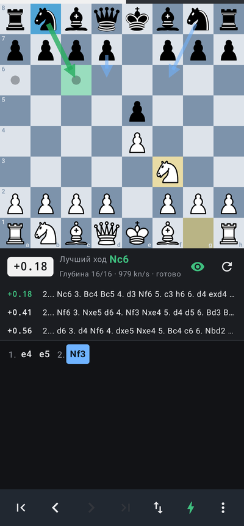
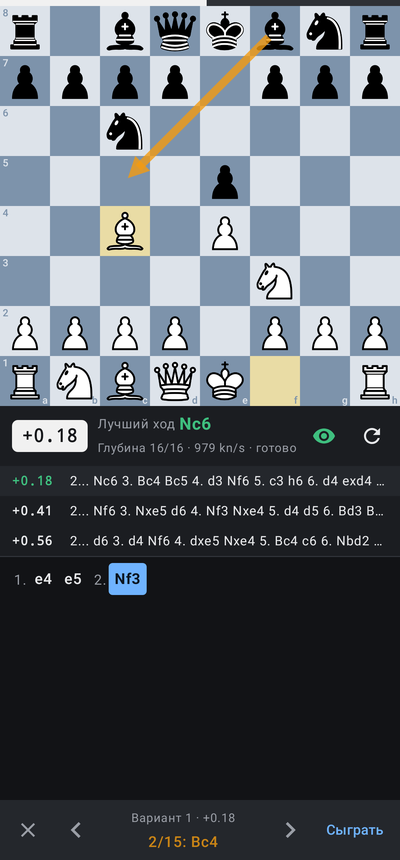
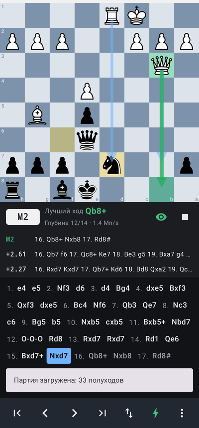

# Stockfish Analyzer (Android)

Персональный шахматный аналитик для Android: вы вводите ходы обеих сторон на доске,
а встроенный **Stockfish 19** анализирует каждую позицию прямо на телефоне, без интернета.

<p>



</p>

## Возможности

- Доска 8×8: ход касанием (фигура → клетка) или перетаскиванием, подсветка выбранной фигуры,
  легальных ходов, последнего хода и шаха; рокировка, взятие на проходе, превращение пешки
  (диалог выбора фигуры); нелегальные ходы невозможны; переворот доски.
- Настоящий Stockfish 19 (UCI), работает локально в отдельном процессе:
  - автоанализ после каждого хода (включается/выключается кнопкой ⚡);
  - оценка в формате `+1.25` / `-0.80`, мат — `M3` / `-M3` (с точки зрения белых);
  - лучший ход в SAN, подсветка клеток «откуда/куда» и стрелка на доске;
  - MultiPV до 5 вариантов (дополнительные варианты — тонкими стрелками);
  - глубина 6–50 или бесконечный анализ, потоки, размер хеша;
  - остановка и повторный запуск анализа.
- Просмотр варианта на доске без изменения партии: нажмите на вариант или 👁 —
  листайте ходы ◀ ▶, «Сыграть» переносит вариант в партию.
- Управление: в начало, отменить ход, вернуть ход, в конец, перевернуть доску,
  автоанализ, меню (новая партия, импорт/экспорт, настройки).
- История ходов в SAN; нажатие на ход переходит к позиции. Новый ход из прошлой
  позиции заменяет продолжение.
- PGN: открыть файл, вставить текст (или FEN), выбор партии из многопартийного файла;
  экспорт — поделиться, сохранить в файл, скопировать. Открытие `.pgn` из других приложений.
- Партия и настройки сохраняются между запусками. Тёмная тема, кнопки внизу для работы одной рукой,
  поддержка альбомной ориентации.

## Архитектура

```
app/src/main/java/com/stockfishmobile/
  chess/   Шахматное ядро на Kotlin: Position (FEN, легальные ходы), San, Pgn, Game
  engine/  UciEngine — UCI-клиент процесса Stockfish; StockfishInstaller — выбор бинарника и сети
  data/    Настройки и автосохранение партии (SharedPreferences)
  ui/      Jetpack Compose: ChessBoard (Canvas), MainScreen, SettingsSheet, AnalysisViewModel
scripts/build_stockfish.sh   Сборка Stockfish из официальных исходников через NDK
```

**Интеграция Stockfish.** Движок собирается из официального тега `sf_19` Android NDK
(`COMP=ndk`) как обычный исполняемый файл и кладётся в APK как `jniLibs/<abi>/libstockfish*.so`.
Android распаковывает его в `nativeLibraryDir` — единственное место, откуда приложению разрешено
запускать файлы (Android 10+). Приложение запускает процесс и общается с ним по UCI через
stdin/stdout. Сборки:

| ABI | Вариант |
|---|---|
| arm64-v8a | `armv8-dotprod` (выбирается автоматически, если CPU поддерживает `asimddp`) и `armv8` |
| armeabi-v7a | `armv7-neon` |
| x86_64 | `x86-64-sse41-popcnt` (эмуляторы) |

Сеть NNUE (`nn-1a298aa575a0.nnue`, 98 МБ) хранится в assets один раз для всех ABI, при первом
запуске копируется во внутреннее хранилище и передаётся через `setoption name EvalFile`.

**Корректность анализа.** При смене позиции во время расчёта клиент отправляет `stop`,
отбрасывает вывод старого поиска до его `bestmove` и только потом запускает новый — на экране
всегда анализ именно текущей позиции. Позиция передаётся как `position fen <start> moves ...`,
поэтому движок учитывает историю (повторения, правило 50 ходов).

**Производительность.** По умолчанию: потоки = ядра − 1 (не более 6), хеш по объёму ОЗУ
(32–256 МБ). При сворачивании приложения анализ останавливается.

## Сборка

Требуется JDK 17+, Android SDK (platform 36) и NDK `28.2.13676358`.

```bash
echo "sdk.dir=$ANDROID_HOME" > local.properties
./gradlew assembleRelease      # первый запуск сам соберёт Stockfish и скачает NNUE
# APK: app/build/outputs/apk/release/app-release.apk
```

Release-сборка подписана debug-ключом, чтобы APK можно было сразу установить.
Для публикации в магазине замените `signingConfig` на свой ключ.
GitHub Actions (`.github/workflows/android.yml`) собирает APK и прикладывает его как артефакт.

Минимальная версия Android — 10 (API 29): под неё собирается Stockfish в NDK-режиме.

## Тесты

```bash
./gradlew testDebugUnitTest
```

- perft на 6 эталонных позициях (chessprogramming.org), FEN, SAN, PGN, повторения;
- с переменными `SF_HOST_BINARY` и `SF_NNUE` (хостовая сборка Stockfish) дополнительно
  запускаются интеграционные тесты UCI-клиента и рендер экрана с реальным анализом
  (`SCREENSHOT_DIR` — куда сохранить скриншоты).

## Лицензии сторонних компонентов

- [Stockfish](https://github.com/official-stockfish/Stockfish) — GPL v3. Распространяя APK,
  необходимо соблюдать условия GPL (в том числе предоставлять исходный код движка).
- Фигуры — набор Cburnett с Wikimedia Commons, CC BY-SA 3.0
  (через [cm-chessboard](https://github.com/shaack/cm-chessboard)).
